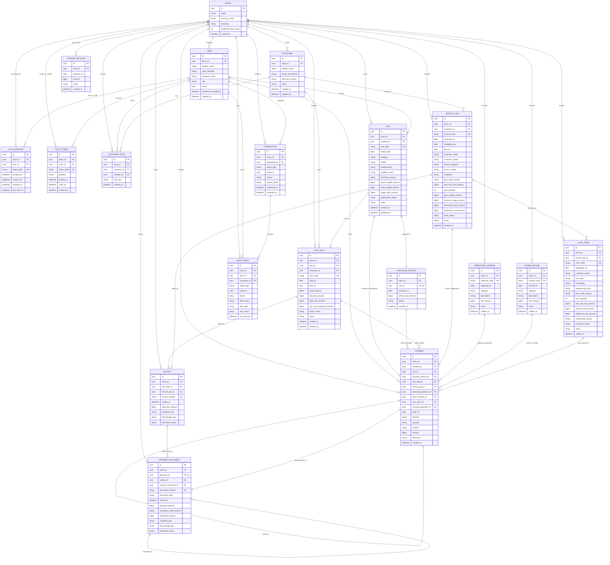
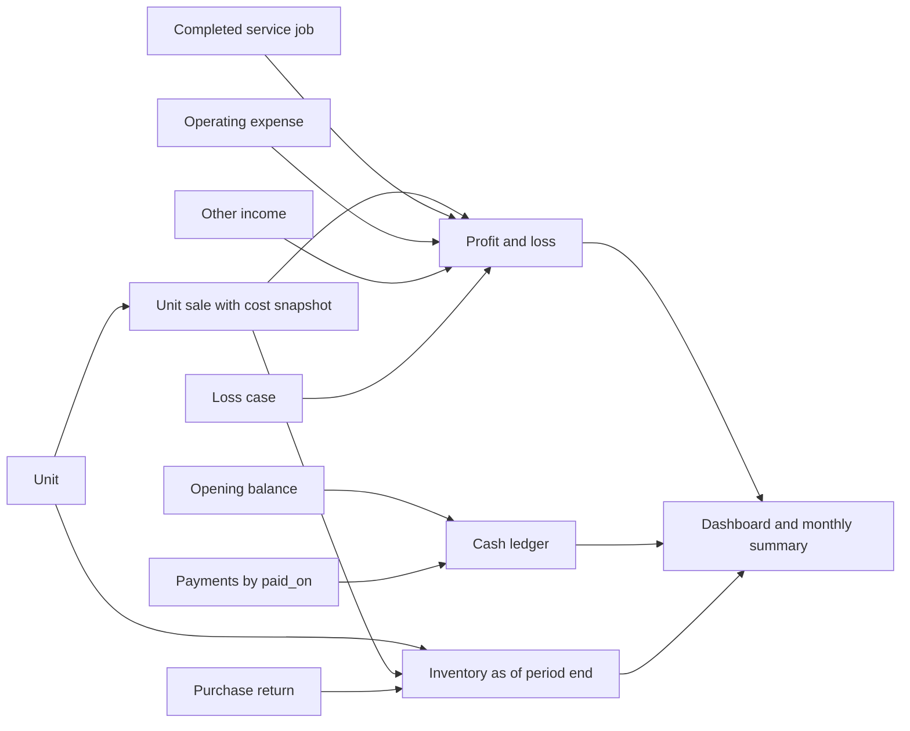

# Entity relationship diagram

**Companion:** [PRD.md](PRD.md) · [WORKFLOWS.md](WORKFLOWS.md)  
**Scope:** Logical MVP schema. Types are technology-neutral; `*_amount` values are nonnegative integer rupiah. Primary keys are stable UUIDs. `store_id` scopes all business data even though the MVP has one store.

## Core ERD

`UNIT ||--o| UNIT_SALE` communicates one active sale in the logical model; history can contain a voided sale. Enforce active uniqueness with a filtered unique index or equivalent transaction rule. `UNIT_SALE.customer_id` is optional only for a fully paid walk-in sale. `SERVICE_JOB.customer_id` is required. Each `PAYMENT` has exactly one source foreign key populated from `unit_id`, `purchase_return_id`, `unit_sale_id`, `service_job_id`, `operating_expense_id`, `other_income_id`, or `loss_case_id`. The diagram shows each possible relationship, not simultaneous ownership. `INVOICE` belongs to exactly one sale or completed service job. `PAYMENT_DOCUMENT` belongs to exactly one payment; its `invoice_id` can be null for an advance received before service completion or for a payout that has no customer invoice.

## Keys, constraints, and derived fields

| Area | Database rule | Derived value / meaning |
| --- | --- | --- |
| Store scope | Every child row's `store_id` must match its referenced parent and acting user. | Prevent cross-store reads and writes. |
| Login identity | Unique `(store_id, login_identifier)`; store only a password hash; disabled users cannot start or continue sessions. Session and invite/reset token values are stored as hashes, expire, and can be revoked or consumed once. | Every request derives user and role from a valid active session. |
| Customer identity | Customer ID is the stable key. Name is required; phone is normalized for search but not unique because contacts may be shared. No automatic merges. Service jobs require a customer; unpaid or DP unit sales require one and at least one contact method. | Customer timeline joins linked jobs/sales, payments, and documents without copying their balances into the profile. |
| Human-readable codes | Unique `(store_id, unit_code)`, `(store_id, sale_code)`, `(store_id, service_code)`, and corresponding expense/income/case codes. | Codes remain searchable and stable. |
| Unit sale | One non-voided sale per unit; save under row lock or equivalent concurrency control. A purchase return and active sale cannot coexist. | Effective stock state comes from sale/return first, then preparation status. |
| Amounts | Nonnegative integer rupiah; `discount_amount <= price_amount`; positive payment amount; payment cannot exceed outstanding due without an approved reversal/refund flow. | `unit_cost = purchase + repair capital + other capital`; `net_sale = price - discount`. |
| Sale cost snapshot | Copy unit cost into `unit_cost_snapshot_amount` at sale posting. Later cost correction creates an audit event and explicitly updates the snapshot if approved. | Historical sale profit remains reproducible. |
| Service | `completed_on` required when status is `Selesai`; `Batal` requires reason. Part quantity and unit cost are both present when a part is used. A positive advance before completion requires a recorded estimate. | `invoice = part_charge + service_charge` once complete; `direct_cost = part_unit_cost × quantity + technician_cost`. Before then, receipts are deposits. |
| Loss | If part code is present, use quantity × unit cost; otherwise use manual cost. Never post the same service part cost as both direct cost and loss. | `loss_total = selected_base_cost + additional_cost`. |
| Payment | Exactly one source FK; direction/purpose valid for source; `reverses_payment_id` may refer only to an original payment in the same store and cannot be reused. Posted payments are append-only. Finalized customer receipts cannot exceed invoice due; unfinished service deposits cannot exceed the agreed estimate without owner correction. | Source balance and payment status derive from net valid linked payments. |
| Transaction invoice | Exactly one of `unit_sale_id` or `service_job_id`; unique source and `(store_id, invoice_number)`; document snapshot is immutable after issue. | One invoice for the full sale or completed service charge. |
| Payment document | Unique `payment_id` and `(store_id, document_number)`; create in the same database transaction as payment; keep immutable issue snapshot. `corrects_document_id` links later correction notices. | One receipt/voucher per payment, including installments, payouts, refunds, and reversals. PDF can be rendered again from the same document. |
| Opening balance | One active opening balance for the store and effective date in MVP; correction requires owner reason and audit. | `closing_cash = opening + receipts - disbursements` through cutoff. |
| Correction/audit | Corrections have reason and actor; audit events are append-only. Review state changes create more audit events. | Old and new values remain traceable. |

For `PAYMENT`, a practical SQL check is that the count of non-null source foreign keys equals one. Composite foreign keys or server-side checks must ensure source and payment share `store_id`. `purpose` distinguishes a receipt from a sale, a supplier unit purchase payment, a unit repair/capital payout, and a service part or technician payout. A reversal is an opposite-direction payment linked to the original, rather than an in-place mutation.

For `INVOICE`, check that exactly one source FK is non-null. Generate `invoice_number` and `document_number` from store-scoped sequences under concurrency control. A payment and its `PAYMENT_DOCUMENT` must commit together. PDF generation is retryable and must reuse the same immutable snapshot and number. When a service advance later gains a parent invoice, preserve the issued payment document snapshot and expose the invoice association through the service job/payment relationship; do not rewrite the original document.

Customer outstanding balance is a query over finalized sale and service invoices minus valid linked receipts, grouped by `customer_id`. An unfinished service job's receipts are deposits and appear in a separate customer-profile total. A later final invoice absorbs those receipts. If the receipts exceed the final invoice, flag the difference for owner settlement rather than displaying a negative receivable or silently applying it to another job. `due_on` is optional and supports manual follow-up; it does not change recognition dates.

## Report lineage

Reports are queries/views, not editable tables. The P&L uses sale date, service completion date under the proposed policy, and expense/income/loss business dates. Cash uses `PAYMENT.paid_on`. Inventory uses unit intake, sale, and purchase return effective dates. All three views accept the same store and period boundaries.

## Provisional decisions before physical schema migration

1. Confirm that the workbook's `Harga Jasa Teknisi` is a customer charge and add a separate technician cost field. If it is actually a cost, adjust `SERVICE_JOB` and the service workflow before building reports.
2. Confirm service revenue recognition at `completed_on`. If intake date is required instead, update report lineage and cancellation handling.
3. Confirm whether Cash, Transfer, and QRIS belong in one combined balance or separate accounts. Separate accounts would add `CASH_ACCOUNT` and an account FK on `PAYMENT` and `OPENING_BALANCE`.
4. Confirm the purchase return refund and shortfall treatment. `PURCHASE_RETURN` is included so stock and cash can be dated; the accounting entry for any shortfall is pending.
5. Confirm whether spare parts require tracked stock. If yes, add part master, purchase, and consumption entities; manual part fields alone are insufficient.
