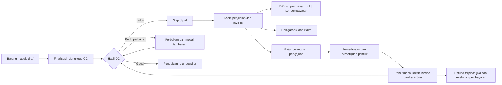
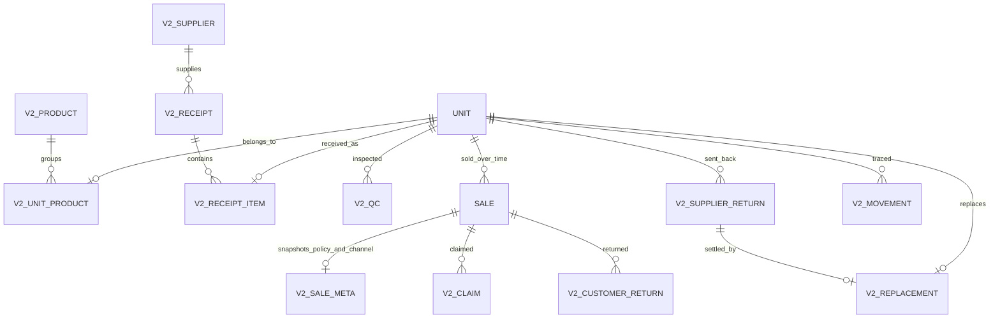

> Referensi modul dan aturan bisnis V2. Versi aplikasi aktif sekarang adalah [V3 (3.0.0)](V3.md).

# TechKasir v2 — Implementasi dan operasi

Implementasi MVP mengacu pada [PRD-V2.md](PRD-V2.md). Design system, login/setup, akun, session, dan preferensi tema tetap menggunakan implementasi sebelumnya. Perluasan yang belum tersedia dijelaskan di bawah.

## Navigasi dan lokasi fungsi

Pemilik melihat Dasbor, Kasir, Riwayat pesanan, Pelanggan, Garansi, Retur pelanggan, Produk, Barang masuk, QC, Retur supplier, Report, dan Pengaturan. Peran lain melihat bagian yang diizinkan, dalam urutan relatif yang sama.

| Area | Implementasi |
| --- | --- |
| Kasir | Katalog kiri, keranjang kanan, harga manual, kanal Toko/Marketplace, pelanggan baru dalam alur, DP/lunas/belum bayar, kembalian tunai, invoice. Satu unit unik per transaksi. |
| Riwayat pesanan | Kartu transaksi kiri dan detail kanan; filter kanal/proses/pembayaran/tanggal/pencarian; pembayaran lanjutan, bukti, cetak nota; tab Servis mempertahankan pekerjaan dan pembayaran servis lama. |
| Pelanggan | Profil dan transaksi lama, hak garansi dan retur terkait pelanggan. |
| Produk | Katalog model/varian dipisahkan dari unit fisik; arsip/aktifkan katalog, daftar unit, perjalanan unit, pembayaran modal, penambahan biaya perbaikan. |
| Barang masuk | Supplier, draf penerimaan, finalisasi atomik, kode/serial unik; unit baru Menunggu QC. Produk katalog opsional mengisi model, kategori, dan spesifikasi. |
| QC | Sepuluh pemeriksaan, Lulus/Perlu perbaikan/Gagal, alasan pengecualian, histori pemeriksa dan pemeriksaan ulang; QC lulus membuka kesiapan jual. |
| Garansi | Versi kebijakan, snapshot hak saat penjualan, tanggal berakhir, pengajuan klaim dan progres hingga selesai/ditolak. |
| Retur pelanggan | Pengajuan, pemeriksaan, persetujuan, penerimaan, kredit penuh invoice, karantina unit, refund terpisah, dokumen kredit. Unit harus QC ulang untuk dijual lagi. |
| Retur supplier | Persetujuan, karantina, pengiriman, refund/pengurangan utang/penggantian. Pengganti berasal dari penerimaan supplier yang sama setelah pengiriman retur. |
| Report | Rentang tanggal, pendapatan/laba/kas/kredit retur/persediaan, ekspor CSV, saldo kewajiban saat ini, kanal, rekap bulanan, pencatatan keuangan, pembayaran. |
| Pengaturan | Tampilan dan saldo awal, versi kebijakan garansi, tab staf dan audit. |

Pencarian global mencakup data lama, klaim garansi, penerimaan, QC, serta retur sesuai izin. Pencarian penjualan menuju detail pesanan. API tetap memeriksa peran dan tidak mengirim modal/HPP kepada kasir.

## Alur barang dan uang



Kredit retur mengurangi tagihan, bukan langsung mengeluarkan uang. Contoh penjualan neto Rp2.900.000 dengan DP Rp1.000.000: retur penuh menghapus piutang Rp1.900.000 dan membuat kewajiban refund Rp1.000.000. Kas berubah ketika refund dicatat. Invoice asal dan bukti DP tetap tersimpan.

Penggantian supplier memindahkan modal unit asal ke unit pengganti dan mencatat nilai pembelian yang ditutup oleh klaim tersebut, tanpa kas atau utang pembelian baru untuk nilai yang ditanggung. Biaya perbaikan/tambahan pada unit pengganti tetap dapat dicatat terpisah. Unit pengganti yang sudah terjual atau sudah dibayar terpisah tidak dapat dipakai untuk penyelesaian ini.

Periode laporan menyaring tanggal pengakuan transaksi, kredit retur pada tanggal penerimaan, dan kas pada tanggal pembayaran. Persediaan adalah posisi akhir periode. Piutang, utang, klaim supplier, serta kewajiban refund pada bagian saldo diberi label **saat ini**, sehingga tidak disajikan sebagai saldo historis.

## Database dan migrasi

`v2.mjs` menambah tabel dengan awalan `v2_`. `sales` dibangun ulang untuk mengganti batas satu penjualan seumur hidup per unit dengan satu penjualan aktif. Trigger database dan validasi dalam transaksi mencegah penjualan aktif ganda; retur yang sudah diterima memungkinkan penjualan ulang tanpa menghapus penjualan asal.



Saat pertama kali server v2 dijalankan, SQLite membuat `data/before-v2-<timestamp>.db` menggunakan `VACUUM INTO` agar WAL ikut tersalin sebelum migrasi. Dengan `TECHKASIR_DATA_DIR`, backup disimpan di direktori data tersebut. Migrasi mempertahankan baris data lama, ID, hash password, session, snapshot dokumen, dan audit. Unit lama mendapat entri katalog individual; nama mirip tidak digabung otomatis. Garansi lama tetap Belum ditentukan, dan unit lama siap jual tidak dipaksa kehilangan statusnya.

Hentikan proses server lama sebelum menjalankan server v2 pada database yang sama. Jalankan dari direktori proyek:

```powershell
node server.mjs
```

Setelah startup berhasil, buka atau refresh [TechKasir lokal](http://127.0.0.1:3000). Session lama tetap berlaku jika belum kedaluwarsa. Untuk rollback, hentikan semua proses yang memakai database, simpan salinan keadaan terbaru, lalu pulihkan backup sebelum v2 bersama kode v1. Jangan menimpa database yang masih aktif.

## Verifikasi

```powershell
node verify.mjs
```

Runner menjalankan enam pemeriksaan lama dan dua pemeriksaan v2, tanpa bergantung pada instalasi npm. Pengujian v2 mencakup penerimaan atomik, serial duplikat, QC, idempotensi penjualan/pembayaran, garansi, kredit dan refund, penjualan ulang, tiga cara penyelesaian retur supplier, transfer modal pengganti, perhitungan laporan, redaksi modal, izin, serta restart database.

`v2-migration.test.mjs` memulai dari database v1 berisi data, termasuk session aktif dan dokumen. `node qa/v2/check-local-migration.mjs` memigrasikan salinan konsisten dari database lokal dan membandingkan fingerprint seluruh tabel lama; sumber dibuka read-only.

Preview terisolasi dengan data fiktif:

```powershell
node qa/v2/preview.mjs
```

Preview memakai database sementara dan port 3002. Akun preview tercetak di terminal dan tidak dibuat di database toko. Pemeriksaan browser menggunakan preview untuk layout desktop 1440px dan seluler 390px, harga manual, kembalian, simpan transaksi, serta detail pembayaran. Preview tidak menerima pembayaran eksternal.

## Batas MVP yang tetap berlaku

- Satu unit per penjualan; UI penerimaan membuat satu unit per draf, sedangkan API menerima beberapa unit.
- Marketplace adalah kanal pencatatan manual, tanpa integrasi layanan eksternal.
- Retur pelanggan mengembalikan satu unit penuh. Retur sebagian, tukar lintas produk, tukar tambah, dan saldo kredit pelanggan belum tersedia.
- Durasi dan cakupan garansi ditetapkan pemilik. Tanpa kebijakan, penjualan baru tidak menjanjikan garansi. Tenggat retur belum diotomatisasi; pemilik memeriksa bukti dan alasan sebelum menyetujui.
- Progres klaim garansi mencatat pemeriksaan dan tindakan; penggantian barang/refund yang berdampak pada stok/uang harus diproses melalui transaksi dan retur terkait.
- Refund final tidak dapat dibatalkan melalui koreksi pembayaran umum. Antarmuka penyesuaian refund khusus belum tersedia.
- Stok sparepart, impor Excel, multi-cabang, backup harian otomatis, dan deployment produksi tetap di luar rilis ini. Invoice/bukti dicetak atau disimpan PDF melalui browser.
