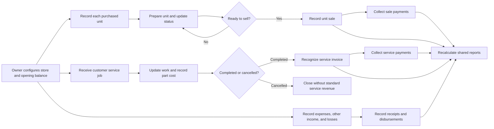
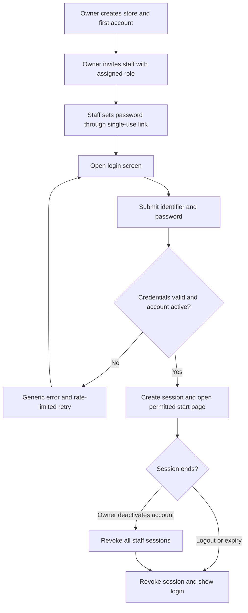
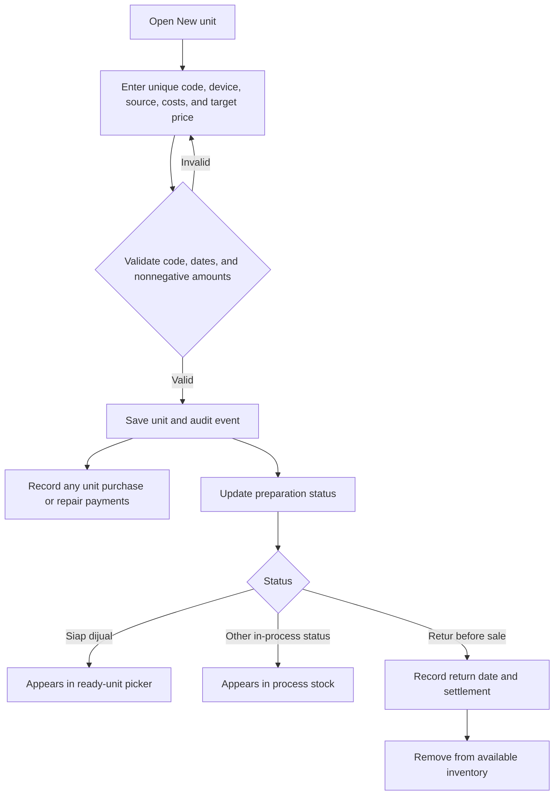
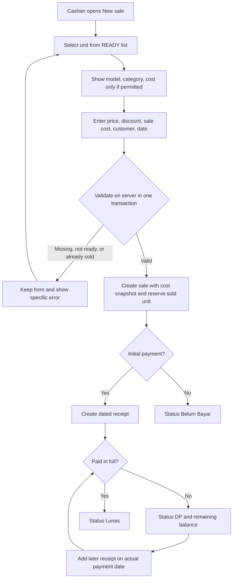
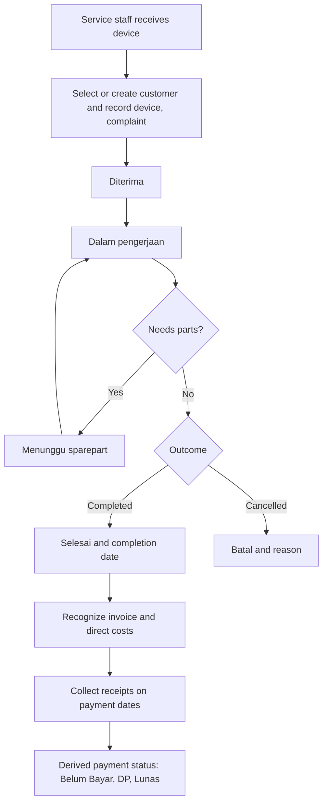
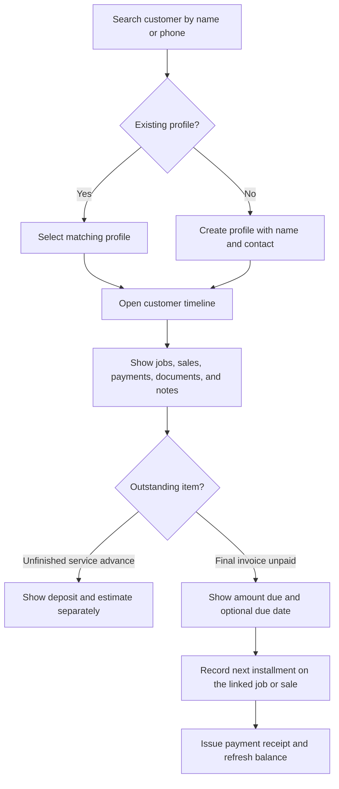
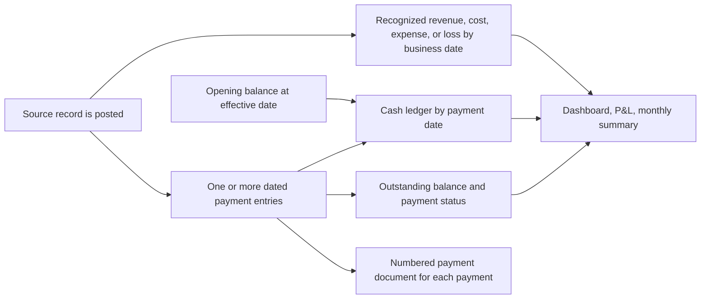
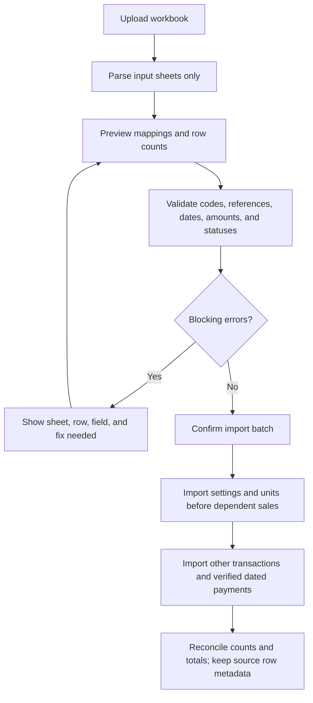

# App workflows

**Companion:** [PRD.md](PRD.md) · [ERD.md](ERD.md) · [DESIGN_REVIEW.md](DESIGN_REVIEW.md)  
**Scope:** Single store MVP. The five accounting and return choices in PRD Section 11 remain provisional; the paths below use its proposed defaults.

## 1. Overall operating flow

The dashboard, profit and loss, and monthly summary are read-only views over the same source records. Cash uses payment dates. Revenue, direct cost, expense, and loss use their defined recognition dates. A change in the preferred report year changes the filter only.

## 2. Setup and roles

### Login and session flow

The first owner account is provisioned during store setup; public sign-up is closed. Password reset uses a short-lived, single-use token and revokes prior sessions. Every protected page, API call, export, and document download checks the current session and role. Failed login/reset attempts are rate-limited and audited without storing submitted passwords. Refreshing a page keeps a valid session; a revoked session returns to login without exposing cached financial data.

1. Owner creates the store, selects the preferred reporting year, and enters the opening cash amount and effective date.
2. Owner invites staff and assigns `owner`, `cashier`, or `service_staff`. Each action checks role on the server.
3. Cashier can see sellable units, create sales, and collect related payments. Service staff can manage service jobs and related payments. Only owner can see full cost/profit and correct posted financial transactions by default.
4. Opening cash is effective only from its dated entry. If a report begins earlier, its starting balance is shown as unavailable until opening data exists.

## 3. Unit intake, preparation, and purchase return

| Rule | Behavior |
| --- | --- |
| One physical unit | One `Unit` record and one store-unique `kode_unit`; never model quantity greater than one for a unit. |
| Cost basis | Purchase price + repair cost on store-owned unit + other capital cost. Changing cost after sale requires an owner correction and an audit reason. |
| Preparation states | `Belum dikerjakan`, `Dalam perbaikan`, `Menunggu sparepart`, `Minus / rusak`, `Siap dijual`, `Retur`. |
| Effective stock view | Active sale → `TERJUAL`; returned purchase → `RETUR`; ready → `READY`; all other preparation states → `DALAM PROSES`. The view is calculated, not editable. |
| Purchase return | Allowed only when there is no active sale. Record return date and supplier refund/settlement. The precise profit/loss treatment of a refund shortfall needs owner confirmation before release. |

Unit intake and a payment may be saved in one transaction, or the payment can be posted later. Saving intake with no payment leaves an outstanding unit payable; it does not create fictional cash outflow. Stock value includes the unit at cost from intake until its sale or purchase return effective date.

## 4. Unit sale and installment collection

**Calculations:** `net_sales = price - discount`; `gross_profit = net_sales - unit_cost_at_sale - sale_cost`; `margin = gross_profit / net_sales` when net sales is positive; `remaining = net_sales - sum(valid sale receipts)`. A sale may have zero payment. The payment method belongs to each receipt, not to the sale as a whole, because installments can use different methods.
When the sale is unpaid or partly paid, selecting or creating a customer is required so staff can locate the debt later. A fully paid walk-in sale may retain only a buyer-name snapshot.

The save operation locks or otherwise serializes the selected unit and enforces one active sale per unit in the database. Two cashiers attempting to sell it simultaneously cannot both succeed. A void requires owner permission and a reason; it reverses the active sale state and uses reversing payment entries where money must be returned. Customer returns and refunds are outside the MVP until a complete policy is defined.

Posting a sale also issues one sale invoice for its net amount. An initial payment issues its own payment document. Each later installment issues another document referencing the same invoice and showing the new remaining balance.

## 5. Customer service

Record part code, unit cost, quantity, customer part charge, and customer service charge. Part inventory is not tracked in MVP. Proposed calculation: `part_cost = unit_cost × quantity`; `invoice = part_charge + service_charge`; `direct_service_cost = part_cost + separately recorded technician_cost`; `service_margin = invoice - direct_service_cost`. The workbook uses `Harga Jasa Teknisi` inconsistently, so the separate technician cost field is provisional until the owner confirms it. Do not show service margin as final before this decision.

Under the proposed accounting policy, invoice and direct costs enter profit and loss on completion date. Receipts can precede completion and appear in cash immediately as an advance, while the job remains unrecognized revenue. Record an agreed estimate before taking an advance. Show the payment as `Uang muka diterima` on the customer and job, with no finalized `Lunas` status. On completion, apply all valid advances to the final invoice and derive `Belum Bayar`, `DP`, or `Lunas`. If advances exceed the final invoice, flag the excess for owner settlement. Cancelling a job with an advance requires owner review for refund or a separately justified charge.
An advance payment receives a numbered `Uang muka` payment document immediately, referencing the service job. Completing a chargeable job issues one service invoice and links prior advance documents to it. Later installments each receive a separate payment document.
Cancellation can be requested from any unfinished work status. A completed job needs an owner correction or a later return/refund policy rather than a silent status change.

### Customer lookup and DP follow-up

Shared phone numbers are not unique customer keys. Show likely matches, then let staff select the right profile or create another. Do not automatically merge profiles. The combined customer receivable sums finalized unpaid invoices only; unfinished service advances appear in a separate deposit section. Manual follow-up notes record contact attempts, while automatic reminders are later scope.

## 6. Expenses, other income, and loss cases

| Flow | Entry | Posted effect | Settlement |
| --- | --- | --- | --- |
| Operating expense | Date, ID, category, description, amount | Reduces profit on expense date | Each actual disbursement reduces cash on payment date. |
| Other income | Date, ID, category, description, amount | Increases profit on earned date | Each actual receipt increases cash on payment date. |
| Loss case | Date, case ID, loss type, details, replacement part/manual cost, additional cost, owner/responsible person | Reduces profit by calculated loss on event date, subject to no double count | Actual paid amount reduces cash on payment date. |

For all three flows: validate unique ID, date, category, nonnegative amounts, and payment not exceeding outstanding balance unless an explicit correction/refund path applies. `LossCase` moves `Baru → Dalam proses → Selesai`; owner can reopen with a reason. A loss that also concerns a service job may link to it for context, but its cost cannot be counted again as service direct cost.

## 7. Payments, balances, and reports

- A payment records direction (`IN` or `OUT`), date, method (`Cash`, `Transfer`, `QRIS`), amount, reference, actor, and exactly one source. Corrections append reversals; posted payment rows are not silently overwritten.
- Payment posting and document-number assignment are atomic. Every posted receipt, payout, refund, and reversal has exactly one issued document record. Customer receipts are `Kuitansi pembayaran`; outflows are `Bukti pembayaran`; reversals carry a correction/void notice. The document is printable and downloadable as PDF.
- A sale or completed service job has one parent transaction invoice. Payment documents reference that invoice when available and show only the amount of that payment, cumulative valid payments, and remaining balance. Reprinting never creates another payment or document number.
- If PDF rendering fails, keep the posted payment and numbered document snapshot, show `PDF belum siap`, and retry rendering against the same document ID. Do not post a second payment. Corrections retain prior documents and issue a linked correction document.
- Combined closing cash = effective opening balance + in-payments − out-payments through the report end date. Method breakdown is separate. A dated cash movement belongs to one period only.
- Remaining receivable/payable = finalized source amount due − valid linked settlements. Status is `Belum Bayar`, `DP`, or `Lunas` for finalized receivables; show an equivalent outstanding/part-paid/settled label for payables. Unfinished service deposits are tracked against the estimate separately.
- Report drill-down must list the source records behind each metric. Negative profit is displayed as a negative amount and is never converted to zero.
- Month-end inventory uses events effective through that month end: acquired units minus units sold or returned by then. Today's stock status must not rewrite a prior month.

## 8. Correction, void, and audit

1. Owner opens the posted record and chooses `Koreksi` or `Batalkan`.
2. App shows current values, proposed new values, and downstream effects (stock, balance, reports). Owner enters a reason.
3. Server validates the change, applies it transactionally, appends field-level `AuditEvent` rows, and creates a `Correction` record with review status `Diperiksa`.
4. A payment correction uses a reversing entry plus a replacement entry. A sale void can release a unit only after payment/refund obligations are handled.
   Each reversing or replacement payment has its own numbered correction/payment document linked to the earlier document.
5. Owner reviews the correction and marks it `Selesai`; the review action itself creates an audit event.

No normal user can edit or delete audit events. A correction that fails validation leaves all source records and balances intact and shows a specific error.

## 9. Workbook import

Ignore prefilled blank formula rows and report sheets. A workbook amount paid without an actual payment date is not sufficient to assign a historical cash month; hold those rows for review. Re-importing the same source batch must be idempotent or present a clear duplicate resolution path. The supplied template has no entered business transactions, so the initial import path should still show an honest `0 transactions` preview.

## 10. Workflow acceptance checklist

- A non-ready or already sold unit cannot be sold, including during concurrent saves.
- An installment changes cash and remaining balance on its own date without changing original sale revenue.
- An unfinished service job does not appear as completed service revenue under the proposed policy; any advance still appears in cash.
- A unit purchase affects inventory and cash when paid, but not cost of goods sold until sale.
- Editing a posted amount requires a reason and leaves an audit trail; payment corrections preserve reversals.
- Login blocks deactivated users and direct access to pages or documents outside their role; logout and password reset revoke the appropriate sessions.
- Two installments produce one parent invoice and two payment documents. Every other posted cash movement, including a payout or reversal, also has a document.
- Searching a customer shows all their service jobs, linked sales, DP receipts, later installments, and finalized outstanding balances. An unfinished service deposit does not inflate receivables.
- Every report figure opens its contributing records and agrees with the same date-range calculations elsewhere.
